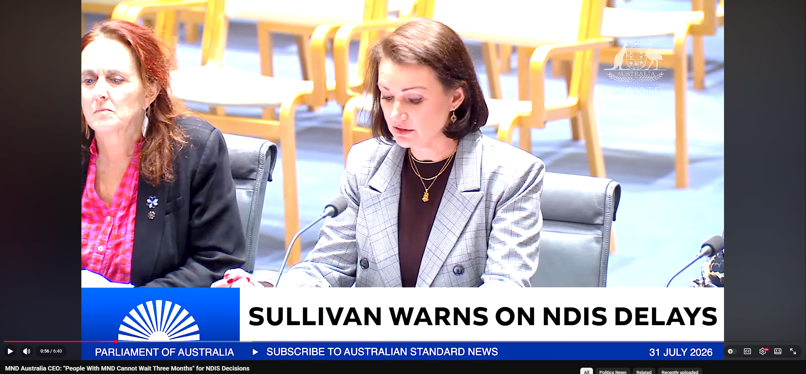
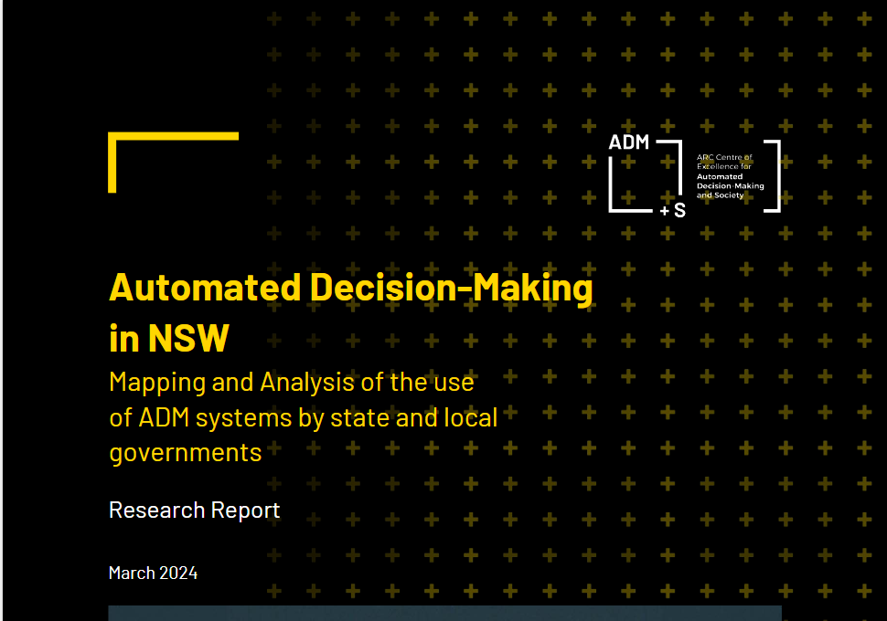

# Final-eportfolio-Automated-Decision-Making
A collection of Artefacts and reflections on my understanding of Automated Decision making
## Artefact 1:

### Summary of the Artefact:
A video describing the upcoming Australian Privacy Principles (APP) being introduced into Australia on December 10. The changes introduce APP 1.7-1.9, principles that ensure businesses must disclose if they are using Automated Decision Making (ADM) influenced by customers information.

### Justification of the Artefact:
I chose this artefact as I liked the breakdown of exactly which parts of ADM the policies are going to target. The policy enforces disclosure of:
    • The data the Artificial Intelligence (AI) is using.
    • Which decisions are being automated.
    • The affects to the customer.
The intention of the privacy laws seem to be ensuring some level of transparency from businesses in regards to AI and how customer information is being used. Whilst penalties outlined are only monetary in nature, overall this feels like an ethical way to ensure that customers are able to make informed decisions about which business to support.

## Artefact 2:

### Summary of the Artefact:
A presentation by Dr Monique Ryan describing some of the impacts of the “Robo-Debt”, a government ADM initiative that used average income to assign debt to citizens receiving income support from 2016-2019. Dr Monique discusses the $475 million dollar settlement, which is the largest commonwealth settlement in Australian history, and how a royal commission found the scheme harmed economically disadvantaged citizens receiving income support.

### Justification of the Artefact:
I chose this artefact due to the personal experience I had with the “Robo-Debt”. Dr Monique Ryan states the $475 million dollar settlement was “commensurate with the scale of the damage and ruin caused by Robo-Debt”(). In 2018 I personally was assigned a $6000 debt while receiving income support, this debt was paid back via taxing of my income. I paid the amount back in full, and in 2024 I received a settlement from the largest commonwealth settlement in Australian history to the tune of $175 dollars. If the only penalties for a crime are financial then the crime only exists for the poor. Under social contract theory everyone follows the rules and there are consequences for breaking them, but that system seems to fall apart when the consequences themselves aren’t equal.
## Artefact 3:
### Summary of the Artefact:
A video further explaining the scope of the upcoming APP being implemented on December 10. This video goes into further details of what is being targeted, definitions of ADM and why these steps are being taken.

### Justification of the Artefact:
This artefact was chosen because of the details this source reveals about the upcoming privacy reforms. The source sates that in 2024 ADM transparency obligations were incorporated into APP 1, however in 2025 a review found only 17% of government agencies were being honest about usage of ADM. True transparency requires understanding, and as such it is important to have comprehensive and rigid definitions of what ADM is. This is interesting to me because there is a legitimate argument that laws regarding transparency require transparency themselves in order to be ethical.

## Artefact 4:

### Summary of the Artefact:
A research report into ADM within New South Wales conducted in 2024. The report is an extensive effort to map out usage of ADM in an effort to bring more visibility towards ADM within business, and the different definitions of what ADM might be.

### Justification of the Artefact:
I chose this report to focus on one section of particular note to myself, however the report is comprehensive and contains many more points of interest. This report seeks to define what is an ADM system, and found that:
    • An ADM system is not only AI.
    • ADM can refer to inflexible tools for decision making, such as risk assessment.
This is fascinating, and is best shown with an example. Say a policy exists that outlines every requirement to get a loan from a bank:
    • If you meet all the policy requirements, the bank must approve the loan.
    • If you don’t meet all the requirements, the bank must deny the loan.
In this scenario the decision isn’t being made by the bank, but by the bank policy, which is indeed a form of ADM. This shows me that definitions are vital to functional policy creation.

## Artefact 5:
### Summary of the Artefact:
CEO Clare Sullivan of Motor Neuron Disease (MND) Australia presenting to the Senate Community Affairs Legislation Committee in regards to the proposed National Disability Insurance Scheme (NDIS) amendments. Clare talks at length about MND, and how current use of ADM is not suitable for the NDIS.

### Justification of the Artefact:
This artefact was chosen due to highlighting what I believe is a key argument against the use of ADM. Clare Sullivan states a particular concern about implementing ADM into the NDIS as these processes fail to account for rapid changes in circumstances due to the impact of MND on a patient. Clare Sullivan suggests that ADM should be used to support clinical judgements without replacing them. ADM lacks a human element that feels critical to making decisions on the health and welfare of at risk citizens.

## Artefact 6:
### Summary of the Artefact:
A research article from Holli Sargeant and Mans Magnusson title "Formalising Anti-Discrimination Law in Automated Decision Systems". The article suggests that there are 3 key limitations to machine learning fairness paradigms.
    • The types of evidence being used to define discrimination.
    • A disconnect between how machine learning models are built and anti-discrimination laws.
    • The majority of evidence regarding discrimination in machine learning is based in the United States.

### Justification of the Artefact:
I chose this artefact because the implication of the third limitation is interesting. What is and isn’t illegal is determined by the jurisdiction. I could argue that what is or isn’t ethical can be influenced by the current environment as well. Would AI that is trained off of data exclusively from the United States end up discriminatory? If that AI is discriminatory is that a valid indication of discrimination within the United States? This suggests to me that it would be very hard to prove a trend in AI is discriminatory, as the information being used may be discriminatory as well.

## References:
Genesys Data 2026, Automated Decision Making – Privacy Reform Australia, online video, viewed 17 October 2026, available at <https://www.youtube.com/watch?v=Rxw2yfw5uzY>.

Kimberlee, W 2024, *Automated decision‑making in NSW: Mapping and analysis of the use of ADM systems by state and local governments*, research paper, CQUniversity, viewed 17 October 2026, doi: 10.25946/26839105.v1.

MND Australia 2024, *MND Australia CEO: “People With MND Cannot Wait Three Months” for NDIS Decisions*, online video, viewed 17 October 2026, available at <https://www.youtube.com/watch?v=fiPbimF3swA>.

